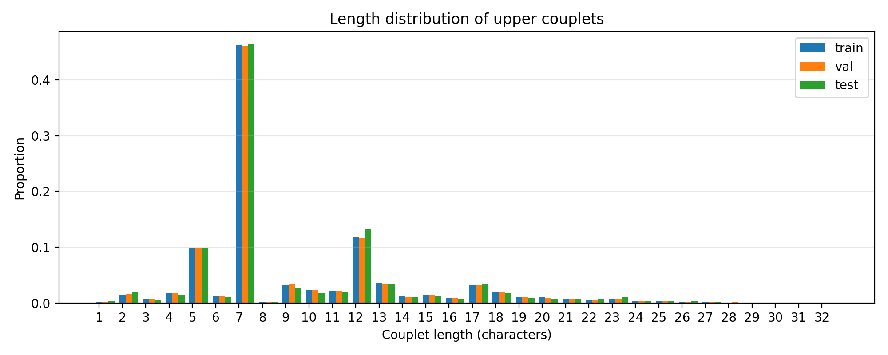
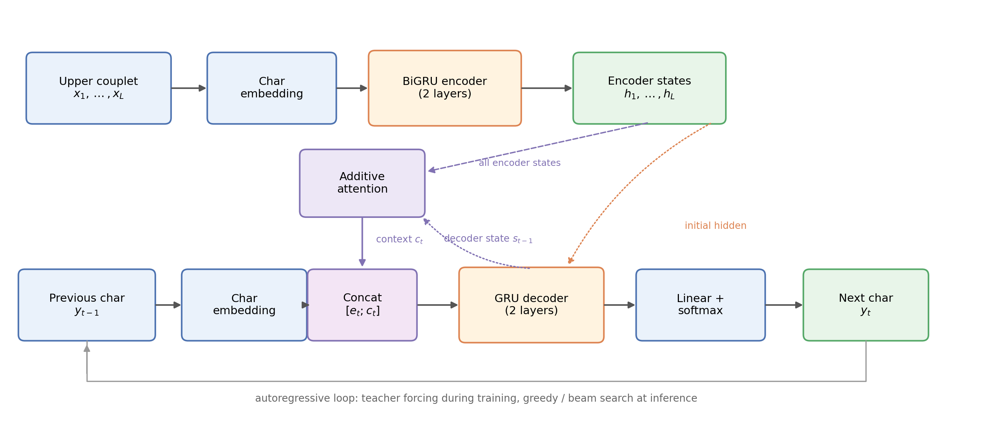
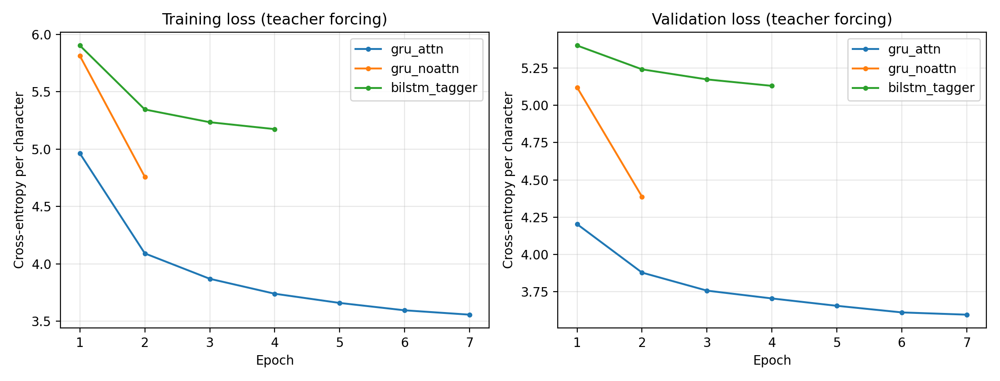
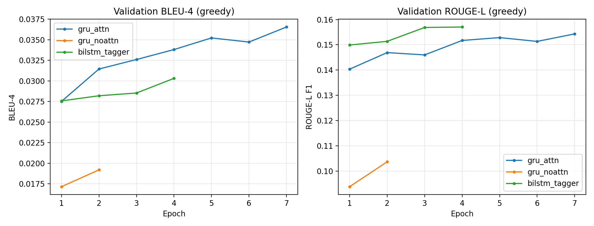
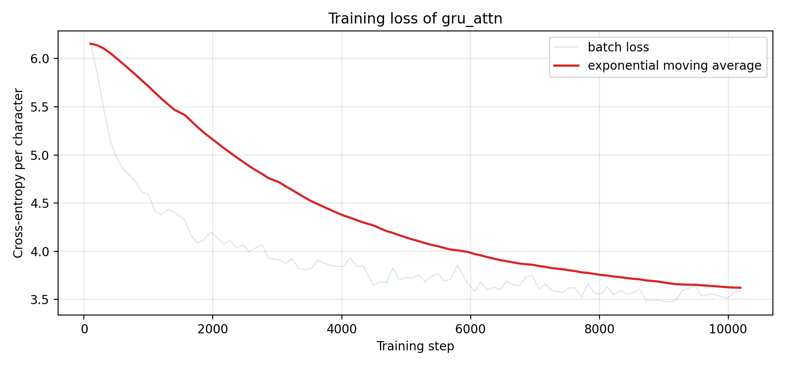
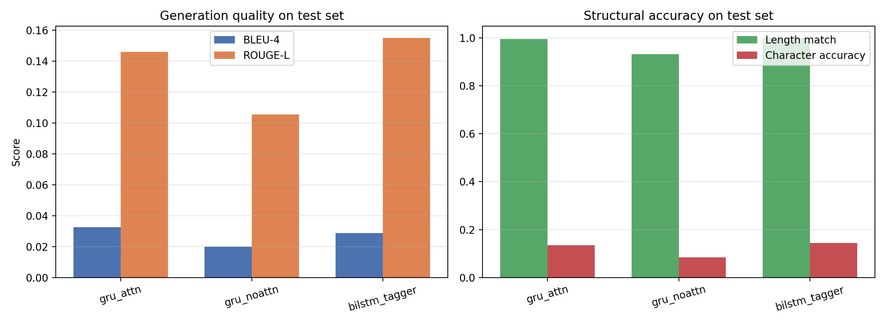

# 基于 Seq2Seq（GRU + Attention）的自动对联生成

**机器学习概论课程项目报告**

## 摘要

本项目以课程样例 CoupletAI 为基础，把“给定上联生成下联”从样例的**序列标注**框架改写为**编码器—解码器（Seq2Seq）**框架，并使用与样例不同的 RNN 结构：2 层双向 GRU 编码器、2 层 GRU 解码器和 Bahdanau 加性注意力。模型在 750,491 条训练对联上训练 7 轮，在从训练集划出的 20,000 条验证集上选择模型，最后在 4,000 条官方测试集上评估；同时训练了复现样例结构的 BiLSTM 序列标注基线和去掉注意力的 Seq2Seq 消融模型。主模型在测试集上取得 BLEU-4 = **0.0326**、ROUGE-L = **0.1459**、长度一致率 **99.6%**、teacher forcing 困惑度 **36.5**；beam=5 时 BLEU-4 提升到 **0.0366**。作为对照，BiLSTM 标注基线的 BLEU-4 为 0.0286、ROUGE-L 为 0.1549，但输出多样性显著更低、困惑度高达 165.5。由于同一上联的两个不同人工下联之间 BLEU-4 平均也只有 0.092，单参考 BLEU 在本任务上非常严苛；定性样例显示模型能生成较工整的下联，但在重复、长联语义和严格对仗上仍有明显不足。

## 1. 任务与数据

### 1.1 任务定义

给定上联字符序列 $X=(x_1,\dots,x_L)$，生成下联字符序列 $Y=(y_1,\dots,y_M)$。对联通常满足：

- **字数相等**：$M=L$，这是样例把问题转化为序列标注的依据；
- **词性、结构相对**：上下联对应位置往往同类词相对；
- **平仄相对、语义相关**：好的下联不仅要对仗，还要与上联意境呼应。

因此该任务既可以被看作“逐位置标注”，也可以被看作“条件序列生成”。本项目采用后者。

### 1.2 数据与预处理

原始数据来自样例目录 `CoupletAI/couplet`：`train/in.txt` 与 `train/out.txt` 分别为上联、下联，每行一句，字符之间以空格分隔；`test/` 为官方测试集；`vocabs` 为字符表。数据统计如下：

| 划分 | 对数 | 平均长度 | 中位数 | 95 分位 | 最大长度 |
| --- | ---: | ---: | ---: | ---: | ---: |
| 训练（原始） | 770,491 | 9.35 | 7 | 19 | 32 |
| 训练（划分后） | 750,491 | 9.35 | 7 | 19 | 32 |
| 验证 | 20,000 | 9.34 | 7 | 19 | 32 |
| 测试 | 4,000 | 9.39 | 7 | 20 | 31 |

所有 770,491 对训练数据都满足上下联等长，且长度不超过 32；长度分布呈明显双峰：约 61.8% 是 7 字以内的短联（其中绝大多数是 7 字联），约 19.2% 落在 12–16 字，约 11.0% 超过 16 字。这一分布意味着模型大部分时候生成 7 字下联，但也必须处理长联。



数据中还包含 181,467 条重复上联（占 23.6%），但只有 5,026 对完全重复的上下联对。也就是说，同一个上联可能存在多个不同的合法下联，而测试集只给出其中一个参考下联；这会给 BLEU/ROUGE 带来难以避免的“参考不唯一”误差，分析结果时需要注意。测试集 4,000 条中有 3,997 对唯一上下联对。

进一步统计训练集与测试集的重合情况：测试集有 **33.35%** 的上联在训练集中出现过，但只有 **1.47%** 的完整上下联对在训练集中出现过。这说明模型在测试时可能“见过上联”，但通常没有见过测试集给出的那个下联；因此测试集既不是完全陌生的，也不能靠记忆上下联对来获得高分。

预处理（`preprocess.py`）完成三件事：

1. **字符级词表**：在样例 `vocabs` 的基础上增加 4 个特殊符号 `[PAD]=0`、`[UNK]=1`、`[BOS]=2`、`[EOS]=3`，并跳过原词表中的 `<s>`、`</s>`，最终词表大小 9,132。
2. **序列编码**：上联编码为字符 id；下联编码为 `[BOS] + y_1...y_L + [EOS]`，因此目标长度为 $L+2$。
3. **数据划分**：以固定随机种子从训练集随机抽取 20,000 对作为验证集（约占 2.6%），其余 750,491 对用于训练；官方测试集只在最终评估时使用一次。

由于词表取自原始数据字符表，训练/验证/测试的 OOV（映射到 `[UNK]`）比例均为 **0%**。

## 2. 样例代码分析

### 2.1 样例的做法

样例的核心观察是：对联上下联字数相等，因此可以把下联第 $i$ 个字当作上联第 $i$ 个字的标签，把生成问题转化为逐位置分类：

$$
\hat y_i = \arg\max_{v} P(y_i=v \mid x_1,\dots,x_L)
$$

`module/model.py` 中的 `BiLSTM` 用嵌入层 + 单层 BiLSTM 编码上联，再对每个位置做线性投影并（与词嵌入权重绑定）输出词表分布；训练损失为逐位置交叉熵，掩掉 `[PAD]`。`main.py` 一次前向得到整句下联，再用 BLEU-4、ROUGE-L 评估。

### 2.2 优点与局限

**优点**：一次前向即可输出整句，训练和推理都很快；不存在自回归模型的曝光偏差（exposure bias）；实现简单，BLEU 等指标稳定。

**局限**：

1. **输出长度被输入长度锁死**。模型无法生成与上联不同长度的下联，也无法处理“多一个字/少一个字”的变体；遇到数据中不等长的样本只能截断或补 padding。
2. **没有显式的解码过程**。每个位置在给定 BiLSTM 上下文后独立分类，缺少“已生成前缀 → 下一个字”的条件建模，无法使用 beam search、长度惩罚、重复惩罚等解码技巧。
3. **位置对齐假设过强**。逐位置标注要求上下联严格逐字对应；对于词序调整、虚词省略等情况，模型没有重新对齐的能力。注意力机制可以让解码器在生成每个字时动态回看上联的不同位置，更符合“对仗”的直觉。
4. **没有句子边界符号**。模型不需要学习“何时结束”，但也失去了 Seq2Seq 框架中统一的 BOS/EOS 建模方式。

因此，把框架改成 Seq2Seq 不仅是形式上的要求，也能带来更一般的条件生成能力。

## 3. 方法

### 3.1 整体框架

模型由编码器和解码器组成：

1. **编码器**读入整个上联，得到每个位置的上下文表示；
2. **解码器**从 `[BOS]` 开始，每一步根据“上一个生成的字”和“编码器状态”生成下一个字，直到 `[EOS]` 或达到最大长度。

训练时使用 **teacher forcing**：第 $t$ 步的输入是真实的下联第 $t-1$ 个字，而不是模型自己的预测；推理时使用模型自己上一步的输出（贪心或 beam search）。整体结构见下图。



### 3.2 编码器

设字符嵌入矩阵为 $E\in\mathbb{R}^{V\times d}$，上联 $x_{1:L}$ 的嵌入为 $e_i=E[x_i]$。编码器是 2 层双向 GRU：

$$
\overrightarrow{h}_i=\overrightarrow{\mathrm{GRU}}(e_i,\overrightarrow{h}_{i-1}),\qquad
\overleftarrow{h}_i=\overleftarrow{\mathrm{GRU}}(e_i,\overleftarrow{h}_{i+1}),
$$

$$
h_i=[\overrightarrow{h}_i;\overleftarrow{h}_i]\in\mathbb{R}^{2H}.
$$

取最后一层正向、反向的最终状态拼接，经线性层和 tanh 得到解码器初始状态：

$$
s_0=\tanh\left(W_b\,[\,\overrightarrow{h}_L;\overleftarrow{h}_1\,]+b_b\right).
$$

编码器使用 `pack_padded_sequence`，避免在 padding 位置上做无意义的循环计算。

### 3.3 加性注意力

解码器第 $t$ 步对编码器所有位置计算注意力分数：

$$
e_{t,i}=v^\top\tanh\left(W_h h_i+W_s s_{t-1}\right),
\qquad
\alpha_{t,i}=\frac{\exp(e_{t,i})}{\sum_{j=1}^{L}\exp(e_{t,j})},
$$

其中对 padding 位置做 mask（分数置为 $-\infty$）。上下文向量为

$$
c_t=\sum_{i=1}^{L}\alpha_{t,i}h_i.
$$

注意力让模型在生成“红”时重点看上联的“绿”、生成“花”时重点看“柳”，从而学习对仗关系，而不是机械地按位置复制。

### 3.4 解码器与训练目标

解码器是 2 层 GRU。第 $t$ 步输入为“上一步字符嵌入”与“注意力上下文”的拼接：

$$
s_t=\mathrm{GRU}\left([E[y_{t-1}];c_t],s_{t-1}\right),
$$

输出层把解码状态与上下文拼接后映射到词表：

$$
P(y_t\mid y_{<t},X)=\mathrm{softmax}\left(W_o[s_t;c_t]+b_o\right).
$$

训练目标为带 `[PAD]` 掩码的逐字交叉熵：

$$
\mathcal{L}=-\frac{1}{N}\sum_{t=1}^{M}\log P(y_t\mid y_{<t},X),
$$

其中 $N$ 是真实目标字符数（不含 padding）。使用 Adam 优化器、梯度裁剪和混合精度训练。

### 3.5 推理

- **贪心解码**：每一步取概率最大的字，遇到 `[EOS]` 停止。用于验证集每轮快速评估和测试集主结果。
- **束搜索（beam search）**：维护 $k=5$ 条候选路径，按累计对数概率排序，并用长度惩罚

$$
\mathrm{score}(Y)=\frac{1}{|Y|^{\alpha}}\sum_{t}\log P(y_t\mid y_{<t},X),\qquad \alpha=0.6
$$

选择最终结果。用于展示样例。束搜索通常能缓解贪心解码“一步错、步步错”的问题，生成更通顺的下联。

### 3.6 模型规模与超参数

| 组件 | 设置 | 参数量 |
| --- | --- | ---: |
| 字符嵌入（编码器） | 9,132 × 256 | 2,337,792 |
| 编码器 | 2 层 BiGRU，hidden 256，含初始状态 bridge | 2,234,880 |
| 注意力 | 加性注意力，256 维 | 196,864 |
| 字符嵌入（解码器） | 9,132 × 256 | 2,337,792 |
| 解码器 | 2 层 GRU，输入 768（256 嵌入 + 512 上下文），hidden 256 | 1,182,720 |
| 输出层 | 768 → 9,132 | 7,022,508 |
| **合计** |  | **15,312,556** |

与样例的对照：

| 方面 | 样例 | 本项目 |
| --- | --- | --- |
| 框架 | 序列标注 | Seq2Seq |
| RNN | 单层 BiLSTM（默认） | 2 层 BiGRU 编码 + 2 层 GRU 解码 |
| 注意力 | 无 | Bahdanau 加性注意力 |
| 解码 | 一次前向 argmax | 逐字生成 + beam search |
| 边界符号 | 无 | BOS/EOS |
| 参数量 | 约 2.8M（基线，单层 BiLSTM） | 约 15.3M |

## 4. 实验设置

### 4.1 运行环境

- GPU：NVIDIA GeForce RTX 4060 Laptop GPU（8 GB）
- Python 3.13，PyTorch 2.10.0 + CUDA 12.6
- 混合精度：`torch.amp` FP16
- 训练框架：PyTorch，单卡

### 4.2 训练超参数

| 超参数 | 主模型（GRU + Attention） |
| --- | --- |
| 词表大小 | 9,132 |
| 最大长度 | 32 |
| 嵌入维度 | 256 |
| 隐藏维度 | 256 |
| 编码器层数 | 2（双向） |
| 解码器层数 | 2 |
| dropout | 0.2 |
| batch size | 512 |
| 优化器 | Adam |
| 学习率 | 1×10⁻³ |
| 梯度裁剪 | 3.0 |
| teacher forcing | 1.0 |
| 训练轮数 | 7 轮（验证损失连续 2 轮不降则早停，本次未触发） |
| 学习率调度 | ReduceLROnPlateau（factor 0.5，patience 1） |
| 随机种子 | 42 |

### 4.3 对比方法

为了说明“框架改动”和“注意力”的作用，训练以下三个模型，并在同一测试集上评估：

1. **主模型**：Seq2Seq（BiGRU 编码器 + GRU 解码器 + 加性注意力），上述设置。
2. **序列标注基线**：复现样例的 BiLSTM 标注结构（嵌入 256、单层 BiLSTM、输出与嵌入权重绑定），相同训练/验证数据和 batch size；由于标注模型训练更快，使用 4 轮训练。
3. **无注意力消融**：把主模型的注意力去掉（解码器只依赖上一步字符嵌入和循环状态），其余结构与超参数一致；为了在相同训练预算下比较，训练 2 轮，与主模型第 2 轮的验证指标对比。

### 4.4 评估指标

- **BLEU-1/2/3/4**：使用 NLTK `sentence_bleu`，平滑方法 method 1，与样例一致；报告的是 4,000 条测试样本的句子级平均值。
- **ROUGE-L**：基于最长公共子序列的 F 值（β=1.2），与样例一致。
- **完全匹配率（Exact Match）**：生成的下联与参考下联逐字完全相同的比例。
- **长度一致率**：生成长度等于参考长度的比例。
- **字级准确率**：按位置比较生成字与参考字，在参考长度上取平均。
- **distinct-1/2**：生成语料中不同 1-gram/2-gram 占全部 1-gram/2-gram 的比例，用于观察重复程度。
- **困惑度（PPL）**：teacher forcing 下测试集交叉熵的指数。

### 4.5 参考不唯一的度量上限

对联是开放生成任务：同一个上联可以有多个都算正确的下联。为了估计单参考 BLEU/ROUGE 的“人类分歧”水平，我们从训练集中找出 70,166 个拥有至少两个**不同**人工下联的上联，随机抽取 3,000 对“同一上联的不同人工下联”，计算它们之间的指标（`analyze_references.py`）：

| 指标 | 两个不同人工下联之间 |
| --- | ---: |
| BLEU-4（均值 / 中位数 / 90 分位） | 0.0920 / 0.0203 / 0.2857 |
| ROUGE-L | 0.1948 |
| 字级准确率 | 0.1838 |
| 完全匹配率 | 0.0000 |

可以看到，即使两句话都是人写的、且都合法，它们的 BLEU-4 平均也只有 0.092，中位数只有 0.020；完全匹配率为 0。因此在本任务中，BLEU-4 的低值并不必然意味着生成质量差，必须结合 ROUGE-L、字级准确率和定性样例一起分析。

## 5. 实验结果

### 5.1 训练过程

主模型训练 7 轮，每轮约 10–12 分钟（RTX 4060 Laptop，FP16），总计约 80 分钟。验证集指标如下（验证集 20,000 对；BLEU/ROUGE 在每轮随机抽取的 1,000 条验证样本上用贪心解码计算）：

| epoch | train loss | val loss | val PPL | BLEU-4 | ROUGE-L | 长度一致率 | 字级准确率 |
| ---: | ---: | ---: | ---: | ---: | ---: | ---: | ---: |
| 1 | 4.9630 | 4.2035 | 66.92 | 0.0275 | 0.1403 | 0.975 | 0.1286 |
| 2 | 4.0909 | 3.8787 | 48.36 | 0.0314 | 0.1469 | 0.992 | 0.1363 |
| 3 | 3.8696 | 3.7579 | 42.86 | 0.0326 | 0.1460 | 0.999 | 0.1359 |
| 4 | 3.7392 | 3.7055 | 40.67 | 0.0338 | 0.1517 | 0.995 | 0.1419 |
| 5 | 3.6589 | 3.6561 | 38.71 | 0.0352 | 0.1528 | 1.000 | 0.1428 |
| 6 | 3.5948 | 3.6119 | 37.04 | 0.0347 | 0.1513 | 0.996 | 0.1408 |
| 7 | 3.5567 | 3.5968 | 36.48 | 0.0366 | 0.1543 | 0.994 | 0.1438 |







观察：

1. 训练损失从 4.96 降到 3.56，验证损失从 4.20 降到 3.60，验证困惑度从 66.9 降到 36.5，说明模型确实在学习下联的字符分布。
2. 训练损失与验证损失非常接近（末期 3.56 vs 3.60），没有明显过拟合。这与数据量（75 万对）远大于模型参数量（15.3M）相符；也说明主要矛盾是**拟合/优化不足**，而不是过拟合。
3. BLEU-4 从 0.0275 提升到 0.0366，ROUGE-L 从 0.1403 提升到 0.1543，字级准确率从 0.129 提升到 0.144；但第 4 轮之后提升幅度明显变小，说明单参考 BLEU 已接近该模型/解码方式的平台。
4. 长度一致率在第 2 轮就达到 99% 以上，说明模型学会了在正确的位置输出 `[EOS]`，不需要额外的长度约束。

### 5.2 测试集结果

在 4,000 条官方测试集上：

| 解码方式 | BLEU-1 | BLEU-2 | BLEU-3 | BLEU-4 | ROUGE-L | 完全匹配 | 长度一致 | 字级准确率 |
| --- | ---: | ---: | ---: | ---: | ---: | ---: | ---: | ---: |
| 贪心 + 自由 EOS | 0.1523 | 0.0703 | 0.0435 | 0.0326 | 0.1459 | 0.00125 | 0.9963 | 0.1353 |
| 贪心 + 固定长度 | 0.1523 | 0.0703 | 0.0434 | 0.0325 | 0.1458 | 0.00125 | 1.0000 | 0.1353 |
| beam=5 + 固定长度（1,000 条子集） | 0.1569 | 0.0764 | 0.0483 | 0.0366 | 0.1505 | 0.00300 | 1.0000 | 0.1402 |
| 贪心 + 固定长度（同一 1,000 条子集） | 0.1566 | 0.0715 | 0.0440 | 0.0325 | 0.1494 | 0.00100 | 1.0000 | 0.1381 |

测试集 teacher forcing 损失为 **3.5961**，困惑度 **36.46**。

观察：

1. **自由 EOS 与固定长度几乎完全一样**（BLEU-4 0.0326 vs 0.0325，字级准确率相同），长度一致率已达 99.6%。说明模型已经学会正确停止，推理时不需要利用“上下联等长”的先验去强制长度。这一点与样例的序列标注形成对比：Seq2Seq 自己学会了句子边界。
2. **beam search 有效**：在相同的 1,000 条子集上，beam=5 把 BLEU-4 从 0.0325 提升到 0.0366（+12.6%），BLEU-2 从 0.0715 提升到 0.0764，完全匹配率从 0.001 提升到 0.003，字级准确率从 0.1381 提升到 0.1402。ROUGE-L 只提升 0.001，说明 beam 主要改善的是较长 n-gram 的连贯性，而不是逐字重合。
3. 完全匹配率很低（0.125%），符合开放生成任务的性质；BLEU 和 ROUGE 的绝对数值也不高，原因将在 5.4 节结合“参考不唯一”分析。

### 5.3 与序列标注基线、无注意力消融的对比

序列标注基线复现样例的 BiLSTM 结构（嵌入 256、单层 BiLSTM、输出与嵌入权重绑定），在相同训练/验证数据上训练 4 轮（每轮约 3.7 分钟）。主模型与基线在测试集上的对比如下：

| 模型（全测试集，贪心） | BLEU-1 | BLEU-2 | BLEU-3 | BLEU-4 | ROUGE-L | 完全匹配 | 长度一致 | 字级准确率 | distinct-1 | distinct-2 | 测试 PPL |
| --- | ---: | ---: | ---: | ---: | ---: | ---: | ---: | ---: | ---: | ---: | ---: |
| BiLSTM 序列标注（样例结构） | 0.1629 | 0.0644 | 0.0379 | 0.0286 | 0.1549 | 0.0000 | 1.0000 | 0.1438 | 0.0193 | 0.3766 | 165.51 |
| GRU Seq2Seq（本模型） | 0.1523 | 0.0703 | 0.0435 | 0.0326 | 0.1459 | 0.0013 | 0.9963 | 0.1353 | 0.0541 | 0.4554 | **36.46** |

对比结果比较微妙：

1. **序列标注在“逐字重合”类指标上更强**：BLEU-1、ROUGE-L、字级准确率分别高 0.0106、0.0090、0.0085。这符合直觉：标注模型直接利用位置对齐，且输出层与嵌入权重绑定，容易复制高频的“对仗字”，因此在单字层面和 LCS 上占优。
2. **Seq2Seq 在“多字连贯性”上更强**：BLEU-2/3/4 分别高 0.0059、0.0056、0.0039，其中 BLEU-4 高约 14.0%；在 1,000 条子集上使用 beam=5 后 BLEU-4 进一步达到 0.0366（同一子集贪心为 0.0325）。这说明自回归解码建模了“已生成前缀”，能产生更长的连续词组，而标注模型各位置条件独立，容易出现“每个字都像对的、连起来不自然”的情况。
3. **Seq2Seq 的输出多样性明显更高**：distinct-1 为 0.0541，是基线（0.0193）的 2.8 倍；distinct-2 为 0.4554，也高于基线（0.3766）。标注模型的 BLEU-1 高但 distinct-1 极低，说明它倾向于反复输出同一批高频字（例如“春”“风”“花”“月”），生成结果更“模板化”。
4. **Seq2Seq 的似然好得多**：teacher forcing 测试损失主模型为 3.596，基线为 5.109，困惑度 36.5 vs 165.5。这说明在给定真实前缀的条件下，Seq2Seq 对下一个字的预测置信度高得多；标注模型没有前缀信息，逐位置分类本身更难。
5. **训练成本**：基线每轮约 3.7 分钟、4 轮共约 15 分钟；主模型每轮约 10–12 分钟、7 轮共约 80 分钟，约 5.4 倍。若按相同轮数比较（都取第 4 轮），Seq2Seq 的验证 BLEU-4 为 0.0338，仍高于基线的 0.0303；但 ROUGE-L（0.1517 vs 0.1570）和字级准确率（0.1419 vs 0.1453）仍略低于基线。这与上面的“多字 vs 单字”差异一致。

无注意力消融（2 轮，与主模型第 2 轮同预算）的结果：

| 模型（第 2 轮） | val loss | BLEU-4 | ROUGE-L | 长度一致 | 字级准确率 |
| --- | ---: | ---: | ---: | ---: | ---: |
| GRU Seq2Seq + 注意力（主模型） | 3.8787 | 0.0314 | 0.1469 | 0.992 | 0.1363 |
| GRU Seq2Seq 无注意力（消融） | 4.3873 | 0.0192 | 0.1036 | 0.932 | 0.0809 |



测试集上的差距同样明显（均为固定长度贪心解码，4,000 条）：

| 模型 | BLEU-4 | ROUGE-L | 字级准确率 | 测试 PPL |
| --- | ---: | ---: | ---: | ---: |
| 有注意力（主模型） | 0.0325 | 0.1458 | 0.1353 | **36.46** |
| 无注意力（消融） | 0.0200 | 0.1053 | 0.0847 | 79.71 |

去掉注意力后，验证损失从 3.879 升到 4.387（+13.1%），BLEU-4 从 0.0314 降到 0.0192（−38.9%），ROUGE-L 从 0.1469 降到 0.1036（−29.5%），字级准确率从 0.1363 降到 0.0809（−40.6%），测试困惑度从 36.5 升到 79.7（翻倍），长度一致率也从 99.2% 降到 93.2%。原因很直接：没有注意力时，编码器必须把整个上联压缩进一个固定维度的最终状态，解码器在生成每个字时无法回看具体位置，既容易丢失长联信息，也难以判断何时该输出 `[EOS]`；模型倾向于输出高频通用字，生成结果更短、更重复。这一消融说明**注意力不是可有可无的装饰，而是本模型能工作的关键组件**。

### 5.4 与“人类参考分歧”的对比

第 4.5 节给出了同一上联的两个不同人工下联之间的指标。把它作为“人类之间的分歧水平”，与本模型对比：

| 指标 | 两个不同人工下联 | 本模型（贪心，全测试集） | 本模型 / 人类分歧 |
| --- | ---: | ---: | ---: |
| BLEU-4 | 0.0920（中位数 0.0203） | 0.0326 | 35.4%（中位数的 1.6 倍） |
| ROUGE-L | 0.1948 | 0.1459 | 74.9% |
| 字级准确率 | 0.1838 | 0.1353 | 73.6% |
| 完全匹配率 | 0.0000 | 0.0013 | — |

这说明：

- 如果只用一个参考下联，即使是另一个**完全合法**的人工下联，BLEU-4 平均也只能拿到 0.092，中位数只有 0.020。本模型的 0.033 已经高于“人类参考对”的中位数，说明 BLEU-4 的绝对值低很大程度上是**参考不唯一**造成的，而不完全是模型不会对对联。
- 在 ROUGE-L 和字级准确率上，模型达到人类参考对之间约 74%–75% 的水平；考虑模型还可能出现语义错误，这个差距是合理的，但也说明还有提升空间。
- 需要强调：这里的人类参考对都是合法下联，而模型输出不一定合法，因此该对比只能说明“单参考指标的严苛程度”，不能证明模型已经达到人类水平。

### 5.5 定性样例

用 beam=5、固定长度解码，从测试集中选取的典型输出如下（`results/samples/examples_beam.md` 与 `results/samples/demo_couplets.txt`）：

| 上联 | 参考下联 | 模型生成（beam=5） | BLEU-4 | 说明 |
| --- | --- | --- | ---: | --- |
| 晓风亲绿水 | 暮雨远寒山 | 旭日映红霞 | 0.0000 | 语义、词性都相对，但用字与参考完全不同，BLEU 为 0 |
| 水流知入海 | 树古自参天 | 山峻欲凌云 | 0.0000 | 贪心解码曾生成“山耸欲成山”，beam 修正为通顺下联 |
| 我以真诚溶冷血 | 君凭豪爽闯天涯 | 谁将大义铸忠魂 | 0.0000 | 语义相关，字面完全不同 |
| 九曲风涛喧日月 | 三春雨露润山川 | 三春雨露润春秋 | 0.6148 | 仅“秋/川”一字之差 |
| 春归大地黄牛跃 | 神至人间紫燕飞 | 福到人间紫燕飞 | 0.6148 | “神至/福到”同义替换 |
| 薰风生殿阁 | 皓月照楼台 | 明月照楼台 | 0.6687 | “皓/明”同义替换 |
| 峰峦崇岳巘，峭峙嵯峨峣峻岭 | 河海润津沽，潆洄澎湃汇洪流 | 河海润津沽，潆洄澎湃汇洪流 | 1.0000 | 同偏旁模板：该下联在训练集中与其他上联共现 52 次 |
| 一曲笙歌春似海 | 千门灯火夜如年 | 万家灯火夜如潮 | 0.4111 | 工整、意境相合 |
| 绵世泽惟存孝友 | 振家声不外诗书 | 振家声丕振家声 | 0.1635 | **重复错误**：“振家声”重复 |
| 矿难惊心，车祸揪心，事故痛心，无数心伤源腐败 | 官廉造福，法规护福，安全臻福，几多福利构和谐 | 人能励志，人文励志，人才励志，有余热血荐馨香 | 0.0114 | 长联语义丢失，退化为模板 |
| 勿厌猪肠，高厨总可烹奇味 | 犹胜羊脑，下料偏能变异香 | 不堪鼠肚，老酒当能品品牌 | 0.0203 | **重复错误**：“品品牌” |

这些例子非常清楚地说明了三个问题：

1. **BLEU 为 0 不等于生成错误**。“晓风亲绿水 → 旭日映红霞”与参考“暮雨远寒山”在词性、结构、意境上都算对仗，但用字几乎不重合，因此 4-gram 完全匹配不上。这类输出正是单参考 BLEU 的主要盲区。
2. **beam search 能修正贪心的局部错误**。“水流知入海”贪心输出“山耸欲成山”（重复“山”且语义不通），beam=5 输出“山峻欲凌云”，明显更通顺。
3. **真正的错误集中在重复和长联**：短联上的重复（“振家声”“品品牌”）、长联上的语义漂移和模板化（“矿难惊心……”生成了“人能励志，人文励志，人才励志……”）。这说明模型对长距离语义和篇章结构的建模仍然不足。

另外，模型在测试集上完全匹配的那条 14 字长联，其下联“河海润津沽，潆洄澎湃汇洪流”在训练集中以**其他上联**出现过 52 次（该数据集有大量“同偏旁上联—同偏旁下联”的模板）。因此这个例子更准确地说是“学到了模板对应”，而不是逐字背下了这一对；它同时展示了模型的泛化能力和数据模板化带来的评价虚高。

## 6. 错误分析

结合测试集逐句结果（`results/samples/`）和上面的定性样例，主要错误可以归为以下几类。

### 6.1 重复与退化

最明显的错误是生成重复字或重复短语，例如：

- `绵世泽惟存孝友 → 振家声丕振家声`（“振家声”重复）
- `勿厌猪肠，高厨总可烹奇味 → 不堪鼠肚，老酒当能品品牌`（“品品牌”）
- `日出江花红胜火 → 春来柳柳绿如茵`（“柳柳”）
- `马齿草焉无马齿 → 羊毫毫就有龙章`（“毫毫”）

原因主要有两个：一是 teacher forcing 训练时解码器只见过真实前缀，推理时一旦某一步偏离训练分布，错误会沿着自回归链条放大；二是 GRU 没有显式的重复惩罚，模型在不确定时倾向于反复输出高概率字。beam search 能缓解一部分（例如“水流知入海”从贪心的“山耸欲成山”变为 beam 的“山峻欲凌云”），但不能根治。

### 6.2 长联的语义漂移与模板化

长度超过 16 字的长联只占训练数据的约 11%，模型在长联上明显更吃力：

- `矿难惊心，车祸揪心，事故痛心，无数心伤源腐败 → 人能励志，人文励志，人才励志，有余热血荐馨香`

生成结果保留了“四字短语 + 排比”的表面结构，但把原文的批评/反思语义替换成了泛泛的励志套话。类似地：

- `春暮偶登楼，上下鱼龙，应惜满湖绿水 → 秋风犹入画，纵横风月，不妨一片青山`

结构模仿得不错，但“应惜”与“不妨”的语义关系并不对应。长联的上下文跨度大，GRU 的固定维度状态和单层注意力难以保留全部信息，模型退化为“常见四字模板拼接”。

### 6.3 对仗与词性不工

模型学到的更多是“主题相关”而不是严格的词性、结构对仗。例如：

- `市场经济由妻管 → 商贸精神任我行`（语义偏离，“妻管”与“我行”结构不对应）
- `马齿草焉无马齿 → 羊毫毫就有龙章`（“草/毫”“焉/就”词性不匹配，且重复）

对联要求名词对名词、动词对动词、虚词对虚词，而字符级 Seq2Seq 没有显式的词性/句法监督，只能从数据中隐式学习。训练集中存在大量“同偏旁”“同主题”模板，也强化了这种“看起来像”的倾向。

### 6.4 参考不唯一与模板化评价

第 5.4 节已经说明，单参考 BLEU 会把“语义正确但用字不同”的输出判为 0 分。典型例子：

- `晓风亲绿水 → 旭日映红霞`（参考“暮雨远寒山”，BLEU-4 = 0，但对仗成立）
- `我以真诚溶冷血 → 谁将大义铸忠魂`（参考“君凭豪爽闯天涯”，BLEU-4 = 0）

另一个需要注意的现象是**模板化**：测试集上完全匹配的 14 字长联，其下联在训练集中以其他上联出现过 52 次。数据集里存在大量“同偏旁上联对应同偏旁下联”的模板（例如用水旁字对水旁字、山旁字对山旁字），模型可以借助模板拿到高 BLEU，但这不代表它理解了这一对的具体语义。评价时既要看指标，也要看模型是否只是“套模板”。

### 6.5 曝光偏差

teacher forcing 下的测试困惑度为 36.5，但自由生成时仍会出现明显错误，这是典型的 exposure bias：训练时前缀永远来自真实下联，推理时前缀来自模型自己。beam search 通过保留多条候选路径、用长度归一化的累计对数概率选优，能在一定程度上抵消这种误差累积；实验结果也显示 beam=5 把 BLEU-4 从 0.0325 提升到 0.0366。要进一步缓解，可以使用 scheduled sampling、professor forcing 或强化学习式目标（如 BLEU/ROUGE 奖励）。

### 6.6 数据与字符层面的问题

- 训练集有 5,026 对完全重复的上下联对、181,467 条重复上联，同一上联可能有多个下联，模型在不同参考之间“左右为难”。
- 词表 9,132 个字符中有 1,105 个在训练集中只出现 1 次；这些生僻字、专名、数字、异体字很难学到，测试时容易输出 `[UNK]` 或高频替代字。
- 标点符号（逗号、句号等）占训练字符的约 6.0%，模型需要同时学习“对仗”和“标点位置”，长联的标点更容易错位。

## 7. 结论与改进方向

### 7.1 结论

1. **框架改造完成**：把样例的“逐位置序列标注”改为“编码器—解码器 Seq2Seq”，使用 2 层双向 GRU 编码器、2 层 GRU 解码器和 Bahdanau 加性注意力；训练时 teacher forcing，推理时支持贪心与 beam search。模型自己学会了 `[EOS]`，自由解码的长度一致率达到 99.6%，不再需要像序列标注那样强依赖“上下联等长”。
2. **模型有效**：测试集 teacher forcing 困惑度 36.46，BLEU-4 0.0326，ROUGE-L 0.1459，字级准确率 0.1353；beam=5 把 BLEU-4 提升到 0.0366（+12.6%）。定性样例显示，模型在短联、常见主题上能生成“万家灯火夜如潮”“谁无画意可吟诗”“旭日映红霞”这类工整下联。
3. **与序列标注基线的取舍**：序列标注在 BLEU-1、ROUGE-L、字级准确率上更高（更容易复制高频对仗字），Seq2Seq 在 BLEU-2/3/4、输出多样性和似然上更好（能建模多字连贯性和前缀条件），训练成本约为基线的 6 倍。两种框架各有优势，Seq2Seq 更符合“生成”任务的本质，也提供了 beam search、长度惩罚等可扩展的解码手段。
4. **注意力是关键组件**：在相同训练预算（2 轮）下，去掉注意力会使验证损失从 3.879 升到 4.387、BLEU-4 从 0.0314 降到 0.0192、长度一致率从 99.2% 降到 93.2%；测试集上 BLEU-4、ROUGE-L、字级准确率分别下降约 39%、28%、37%，困惑度翻倍。没有注意力时，固定维度的编码器最终状态成为信息瓶颈，解码器既难以保留长联内容，也难以学会正确停止。
5. **指标解读**：单参考 BLEU 在本任务上非常严苛。两个都合法的人工下联之间 BLEU-4 平均只有 0.092、中位数只有 0.020；本模型的 0.033 已高于人类参考对的中位数，ROUGE-L 和字级准确率达到人类参考对的约 74%–75%。因此不能只看 BLEU 的绝对值，需要结合定性样例和多种指标。

### 7.2 改进方向

1. **缓解曝光偏差**：scheduled sampling、professor forcing、最小风险训练（MRT）或 BLEU/ROUGE 奖励的强化学习微调。
2. **增强解码**：beam search + 长度/重复惩罚、n-gram 阻断、词性/平仄约束；也可以尝试 diverse beam search。
3. **改进模型结构**：input feeding、coverage attention、copy mechanism（处理专名和生僻字）、Transformer Seq2Seq 或预训练语言模型；本次受时间限制只使用了 GRU。
4. **数据层面**：去重、按上联分组划分训练/验证集、清理模板化样本、为生僻字做子字/偏旁建模；引入多参考下联，改用 BERTScore 等语义指标或人工评价。
5. **训练策略**：更长的训练、学习率 warmup/余弦退火、label smoothing、更大的 batch 或梯度累积、调 dropout 和 hidden 维度；本次 7 轮后 BLEU 仍有小幅提升，说明还没有完全收敛。
6. **对联领域知识**：显式建模平仄、词性、上下联字数与结构约束，或者用“先检索模板、再改写”的混合方案。

## 附录：复现命令

```bash
conda activate dip
cd MySolution
python preprocess.py --input ../CoupletAI/couplet --output data --val_size 20000
python train.py --model gru_attn --run_name gru_attn --epochs 7 --batch_size 512
python train.py --model bilstm_tagger --run_name bilstm_tagger --epochs 4 --batch_size 512 \
    --embed_dim 256 --hidden_dim 256 --enc_layers 1
python train.py --model gru_noattn --run_name gru_noattn --epochs 2 --batch_size 512
python evaluate.py --checkpoint results/checkpoints/gru_attn_best.pt --split test --name gru_attn
python evaluate.py --checkpoint results/checkpoints/gru_attn_best.pt --split test --fixed_len --name gru_attn_fixed
python evaluate.py --checkpoint results/checkpoints/gru_attn_best.pt --split test --max_samples 1000 \
    --fixed_len --beam_size 5 --name gru_attn_beam1000
python plot.py --runs gru_attn gru_noattn bilstm_tagger --main_run gru_attn
```

主要结果文件：

- `results/logs/*_epoch.csv`：逐轮训练/验证指标
- `results/metrics/*.json`：测试集指标与参考分歧分析
- `results/samples/*.csv`：逐句生成结果
- `results/figures/*.png`：损失曲线、指标曲线、模型结构、长度分布、模型对比
- `results/samples/demo_couplets.txt`：演示样例


